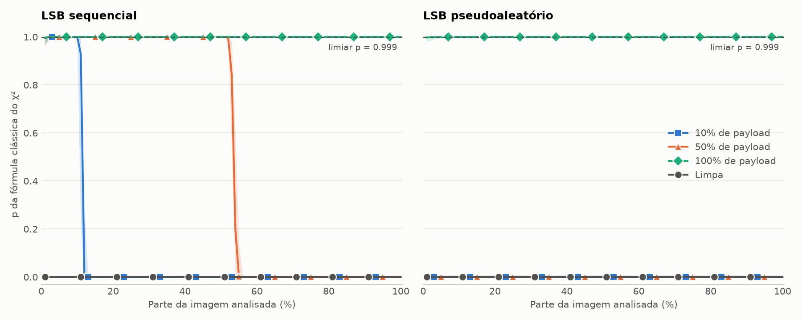
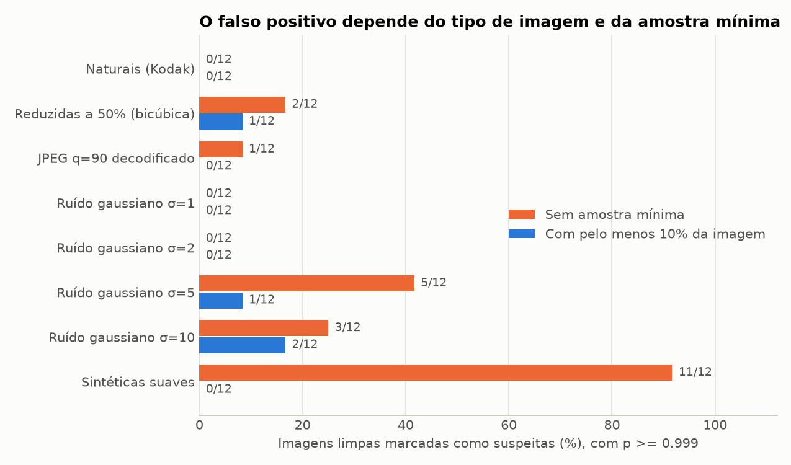
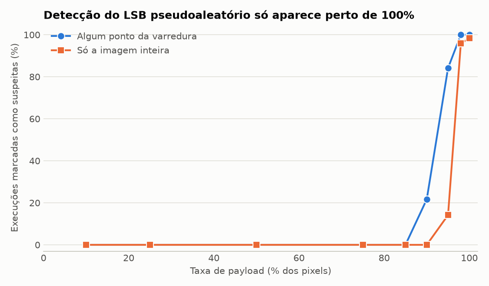

# Projeto 3 — Esteganálise Estatística Espacial: Teste do Qui-Quadrado ($\chi^2$) e Pares de Valores

**Disciplina:** Ocultação de Dados — Especialização Lato Sensu
**Integrantes:**

- AILTON XAVIER
- GUILHERME GOMES LOURENCO
- ROBERTO FARIAS DOS SANTOS
- VICTOR CESAR SAN MIGUEL BUZZO

**Data:** [preencher]

---

## 1. Introdução

A esteganografia busca esconder a própria existência de uma comunicação. O modelo clássico é o problema dos prisioneiros [2]: Alice e Bob trocam mensagens sob a vigilância de Wendy, e a comunicação só tem sucesso se Wendy nem desconfiar dela. A esteganálise é o lado de Wendy: decidir se uma imagem contém mensagem, mesmo sem conseguir lê-la.

A técnica LSB transforma uma imagem de cobertura (*cover*) em uma imagem com mensagem (*stego*), trocando o bit menos significativo dos pixels pelos bits da mensagem. A mudança é invisível, mas altera o histograma de um jeito previsível. O ataque do Qui-Quadrado de Westfeld e Pfitzmann [1] explora essa alteração. Ele pertence à classe SDSS (*Spatial Domain Steganalytic Systems*), que analisa imagens sem compressão no domínio espacial [8, 9].

Este trabalho implementa esse ataque do zero, com NumPy e SciPy, e o avalia em imagens reais sem compressão. Além de medir a detecção, medimos o falso positivo em vários tipos de imagem limpa, porque um detector só é útil se soubermos quando ele erra.

---

## 2. Questões teóricas

### a) Pares de Valores (PoVs) e efeito do payload

Trocar o LSB nunca tira um pixel do seu par: $2k$ só pode virar $2k+1$, e vice-versa. Cada conjunto $\{2k, 2k+1\}$ é um **Par de Valores**, e a soma $h_{2k} + h_{2k+1}$ não muda com a inserção. O que muda é a divisão dentro do par.

Considere que uma fração $\alpha$ dos pixels recebe bits uniformes. Um pixel escolhido fica com qualquer um dos dois valores, com probabilidade ½. Em média:

$$h'_{2k} = \left(1-\tfrac{\alpha}{2}\right)h_{2k} + \tfrac{\alpha}{2}\,h_{2k+1}$$

Subtraindo a expressão equivalente de $h'_{2k+1}$:

$$h'_{2k} - h'_{2k+1} = (1-\alpha)\,(h_{2k} - h_{2k+1})$$

Portanto, as frequências de $2k$ e $2k+1$ se aproximam à medida que o payload aumenta, e a diferença entre elas encolhe na proporção $(1-\alpha)$. Com $\alpha = 1$, as duas se igualam à média do par. Isso vale para bits uniformes, como os de uma mensagem cifrada. A seção 5.5 mostra que texto puro não produz essa igualdade.

### b) Formulação do teste e hipótese nula

**Hipótese nula ($H_0$):** dentro de cada par, os dois valores têm a mesma frequência, como depois de uma inserção LSB completa. Essa inversão é o ponto central do teste: **$H_0$ representa a imagem com mensagem**, e rejeitá-la é evidência de que a imagem está limpa.

Para os $K$ pares com frequência esperada suficiente, a estatística clássica [1] é:

$$\chi^2 = \sum_{k=1}^{K} \frac{(h_{2k} - Z_k)^2}{Z_k}, \qquad Z_k = \frac{h_{2k} + h_{2k+1}}{2}$$

O valor $p$ vem da distribuição $\chi^2$ com $K-1$ graus de liberdade. Valor perto de 1 significa pares equalizados, compatíveis com inserção. Valor perto de 0 significa pares desiguais, o que rejeita $H_0$. Usamos só os pares com $Z_k \ge 5$, critério usual para a aproximação ser válida. Sem ao menos dois pares utilizáveis, o teste não pode ser feito e o resultado é "inconclusivo".

Dois cuidados que medimos e que afetam a leitura do resultado:

1. **$p$ não é a probabilidade de existir mensagem.** Ele mede a compatibilidade dos dados com $H_0$. Por isso, nossos gráficos usam o nome "$p$ da fórmula clássica".
2. **A fórmula clássica não gera um p-valor calibrado.** Ela soma só uma das duas células de cada par, e assim seu valor esperado sob $H_0$ é $K/2$, não $K-1$. O teste de Pearson completo soma as duas células, o que dobra a estatística, e usa $K$ graus de liberdade. A tabela abaixo confirma a diferença em imagens com inserção completa. É por isso que a fórmula clássica mostra $p \approx 1$, enquanto o p-valor de Pearson se distribui de forma aproximadamente uniforme. Mantivemos a fórmula clássica por ser a do método original e por separar bem os casos, tratando $p$ como um indicador.

| Fórmula, com inserção completa (120 execuções) | $\chi^2/K$ mediano | $p$ no quantil 5% | $p$ mediano | $p$ no quantil 95% |
| :--- | ---: | ---: | ---: | ---: |
| Clássica (uma célula, $K-1$ graus) | 0,498 | 0,9998 | 1,0000 | 1,0000 |
| Pearson (duas células, $K$ graus) | 0,996 | 0,051 | 0,497 | 0,912 |

### c) Por que funciona no sequencial e falha no pseudoaleatório ou com pouco payload

**Sequencial.** Os primeiros pixels da imagem ficam totalmente preenchidos. Na varredura cumulativa, cada trecho inicial é como uma imagem com $\alpha = 1$, então $p$ fica perto de 1 até a mensagem acabar e despenca logo depois. A curva mostra a presença da mensagem e também onde ela termina.

**Pseudoaleatório.** Nenhum trecho fica totalmente preenchido: qualquer amostra tem a mesma fração $\alpha$ de pixels usados. Da relação do item (a), derivamos como a estatística depende de $\alpha$:

$$\chi^2(\alpha) = (1-\alpha)^2\,\chi^2_0 + \left[1-(1-\alpha)^2\right]\frac{K}{2}$$

O $\chi^2_0$ da imagem limpa é enorme em relação a $K$. Nas nossas imagens, a mediana é $\chi^2_0 \approx 12.836$ com $K = 124$. Mesmo reduzido pelo fator $(1-\alpha)^2$, ele continua alto demais: com $\alpha = 0{,}5$, o valor previsto é de cerca de 3.250, muito acima de $K$, e $p$ permanece em 0. Na imagem inteira, a fórmula prevê que $p$ só atinge o nosso limiar a partir de $\alpha \approx 96\%$ (entre 95,6% e 97,1%, conforme a imagem). A seção 5.3 confirma isso nas medições.

**Baixo payload.** O efeito é o mesmo: com pouca inserção, $\chi^2$ quase não muda. O sequencial curto tem ainda um problema próprio. A mensagem ocupa um trecho pequeno, e amostras pequenas não permitem distinguir mensagem de imagem limpa (seção 5.2).

### d) Ataque específico e ataque genérico

- **Específico (*targeted*):** é feito para um método de inserção conhecido e explora o artefato que ele deixa. O $\chi^2$ é um exemplo, pois só procura a igualdade dos PoVs do LSB por substituição. *Sample Pair Analysis* [3] e RS [4] também são específicos para LSB e, por usarem a relação entre pixels vizinhos, conseguem estimar payloads pequenos espalhados, justamente onde o $\chi^2$ falha.
- **Genérico (*universal/blind*):** não supõe um método específico. Extrai características estatísticas da imagem e treina um classificador para separar imagens limpas de alteradas [5, 6]. Cobre métodos desconhecidos, mas depende de dados de treino representativos e tende a ser menos preciso que um ataque específico contra o método para o qual este foi criado.

---

## 3. Implementação

| Arquivo | Conteúdo |
| :--- | :--- |
| [`chi_square.py`](chi_square.py) | PoVs, estatística, varredura cumulativa e regra de decisão |
| [`lsb.py`](lsb.py) | Inserção sequencial e pseudoaleatória; inserção e extração de mensagens reais |
| [`entrada.py`](entrada.py) | Leitura de imagens sem destruir os LSBs |
| [`experimento.py`](experimento.py) | Cenários, calibração e métricas |
| [`graficos_exp.py`](graficos_exp.py) | Gráficos |
| [`preparar_dados.py`](preparar_dados.py) | Baixa e confere as imagens e gera os exemplos |
| [`main.py`](main.py) | Linha de comando |
| [`tests/test_projeto.py`](tests/test_projeto.py) | 43 testes automatizados |

As instruções de execução estão no [`README.md`](README.md).

**Decisões de projeto:**

- **Imagens reais.** Usamos as 24 imagens do Kodak Lossless True Color Image Suite [7], em PNG, convertidas para cinza *antes* da inserção. A primeira versão do trabalho usava uma imagem sintética com um desvio imposto entre pares e ímpares, o que forçava $p = 0$ na imagem limpa. Esse desvio foi removido.
- **Repetição.** Cada cenário com mensagem roda em todas as imagens com 5 sementes.
- **Varredura.** São 100 pontos cumulativos, de 1% a 100% dos pixels, na ordem de varredura.
- **Regra de decisão.** A imagem é *suspeita* se algum ponto com ao menos $m\%$ dos pixels tiver $p \ge \tau$. É *inconclusiva* se nenhum ponto puder ser testado; caso contrário, *sem evidência*. Essa terceira opção não afirma que a imagem está limpa, pois o teste não enxerga inserção espalhada.
- **Calibração.** $\tau$ e $m$ foram escolhidos apenas com as 12 imagens de índice par (posição 0, 2, ...), maximizando $J$ = detecção média − falso positivo médio, com o mesmo peso para as 8 classes de imagem limpa. Todas as taxas principais vêm das outras 12 imagens. O resultado foi **$\tau = 0{,}999$ e $m = 10\%$**, ambos dentro da grade testada (`resultados/calibracao.csv`).
- **Imagens coloridas.** O modo `--analisar` testa R, G, B e a sequência RGB intercalada, e marca a imagem se qualquer um deles for suspeito. A primeira versão convertia tudo para cinza, o que apaga os LSBs (seção 5.6).

---

## 4. Resultados: varredura

*A linha mostra a mediana entre execuções, e a faixa clara, o intervalo interquartil.*

| $p$ mediano | 10% | 20% | 30% | 40% | 50% | 60% | 70% | 80% | 90% | 100% |
| :--- | ---: | ---: | ---: | ---: | ---: | ---: | ---: | ---: | ---: | ---: |
| Limpa | 0,0000 | 0,0000 | 0,0000 | 0,0000 | 0,0000 | 0,0000 | 0,0000 | 0,0000 | 0,0000 | 0,0000 |
| Sequencial 10% | 0,9999 | 0,0000 | 0,0000 | 0,0000 | 0,0000 | 0,0000 | 0,0000 | 0,0000 | 0,0000 | 0,0000 |
| Sequencial 50% | 0,9999 | 1,0000 | 1,0000 | 1,0000 | 1,0000 | 0,0000 | 0,0000 | 0,0000 | 0,0000 | 0,0000 |
| Sequencial 100% | 0,9999 | 1,0000 | 1,0000 | 1,0000 | 1,0000 | 1,0000 | 1,0000 | 1,0000 | 1,0000 | 1,0000 |
| Pseudoaleatório 10% | 0,0000 | 0,0000 | 0,0000 | 0,0000 | 0,0000 | 0,0000 | 0,0000 | 0,0000 | 0,0000 | 0,0000 |
| Pseudoaleatório 50% | 0,0000 | 0,0000 | 0,0000 | 0,0000 | 0,0000 | 0,0000 | 0,0000 | 0,0000 | 0,0000 | 0,0000 |
| Pseudoaleatório 100% | 0,9999 | 1,0000 | 1,0000 | 1,0000 | 1,0000 | 1,0000 | 1,0000 | 1,0000 | 1,0000 | 1,0000 |

---

## 5. Resultados: decisões e taxas de erro

### 5.1 Detecção por cenário

Resultados nas 12 imagens fora da calibração, com $\tau = 0{,}999$ e $m = 10\%$:

| Cenário | Regra da varredura | Só a imagem inteira |
| :--- | ---: | ---: |
| Limpa | 0/12 | 0/12 |
| Sequencial 10% | 46/60 (77%) | 0/60 |
| Sequencial 50% | 60/60 | 0/60 |
| Sequencial 100% | 60/60 | 58/60 |
| Pseudoaleatório 10% | 0/60 | 0/60 |
| Pseudoaleatório 50% | 0/60 | 0/60 |
| Pseudoaleatório 100% | 60/60 | 59/60 |

O último ponto suspeito da varredura também estima onde a mensagem termina. O erro médio foi de 0,3 ponto percentual com mensagem de 10% e de 1,5 ponto com mensagem de 50%.

No Sequencial 10%, considerando as 24 imagens, a detecção cai para 81/120 (68%). Esse é o caso mais frágil da regra, porque a mensagem termina exatamente no primeiro ponto aceito. Além disso, essa amostra tem menos pares válidos, o que torna $p$ menos extremo mesmo sob $H_0$.

### 5.2 Falsos positivos

Resultados nas 12 imagens fora da calibração, em imagens sem nenhuma mensagem:

| Classe | Regra final | IC 95% | Sem amostra mínima | Só a imagem inteira |
| :--- | ---: | ---: | ---: | ---: |
| Naturais (Kodak) | 0/12 | 0% a 26% | 0/12 | 0/12 |
| Reduzidas a 50% (bicúbica) | 1/12 | 0% a 38% | 2/12 | 0/12 |
| JPEG q=90 decodificado | 0/12 | 0% a 26% | 1/12 | 0/12 |
| Ruído gaussiano σ=1 | 0/12 | 0% a 26% | 0/12 | 0/12 |
| Ruído gaussiano σ=2 | 0/12 | 0% a 26% | 0/12 | 0/12 |
| Ruído gaussiano σ=5 | 1/12 | 0% a 38% | 5/12 | 0/12 |
| Ruído gaussiano σ=10 | 2/12 | 2% a 48% | 3/12 | 0/12 |
| Sintéticas suaves | 0/12 | 0% a 26% | 11/12 | 0/12 |

Em imagens naturais não processadas, não houve nenhum falso positivo, nem nas 24 imagens somadas (0/24, IC 95% de 0% a 14%). Esse é o máximo que os dados sustentam: **a taxa real pode ser de até 14%, e não podemos afirmar que seja zero.**

A causa dos falsos positivos é consequência direta de $H_0$. Com poucos pixels, a variação amostral esconde a diferença entre os pares, e o teste não consegue rejeitar $H_0$. Como rejeitar $H_0$ é o que indica "limpa", a falta de dados vira um alarme. Por isso, a exigência de amostra mínima reduz os erros: as sintéticas caem de 11/12 para 0/12.

O custo dessa exigência é não detectar mensagens curtas, como mostra a tabela (proporção de execuções detectadas, nas 24 imagens):

| Mensagem sequencial | 10 passos, sem mínimo | 100 passos, sem mínimo | 1000 passos, sem mínimo | **Regra final** |
| :--- | ---: | ---: | ---: | ---: |
| 0,5% | 0% | 0% | 12% | 0% |
| 1% | 0% | 37% | 48% | 0% |
| 2% | 0% | 54% | 68% | 0% |
| 5% | 0% | 72% | 80% | 0% |
| 10% | 70% | 82% | 87% | 68% |

A tabela também justifica os 100 passos: com 10 pontos, nenhuma mensagem menor que 10% é vista. Para procurar mensagens curtas, é possível reduzir a amostra mínima com `--pct-minimo`, aceitando mais falsos alarmes.

O critério $Z_k \ge 5$ também teve custo: com o antigo $Z_k \ge 1$, o Sequencial 10% chegava a 78%, contra 68%, e o falso positivo em imagens naturais continuou zero nos dois casos. Mantivemos 5 por ser o critério estatisticamente defensável.

### 5.3 Detecção em função do payload pseudoaleatório

| Payload $\alpha$ | 10% | 25% | 50% | 75% | 85% | 90% | 95% | 98% | 100% |
| :--- | ---: | ---: | ---: | ---: | ---: | ---: | ---: | ---: | ---: |
| Só a imagem inteira | 0% | 0% | 0% | 0% | 0% | 0% | 14% | 96% | 98% |
| Regra da varredura | 0% | 0% | 0% | 0% | 0% | 22% | 84% | 100% | 100% |
| Erro relativo mediano de $\chi^2$ previsto | 0,4% | 0,8% | 1,7% | 4,4% | 4,0% | 4,3% | 6,6% | 5,0% | 10,9% |

A fórmula da questão (c) prevê a transição na imagem inteira em cerca de 96%, e é onde ela ocorre nas medições. O erro maior perto de 100% é esperado: ali o $\chi^2$ fica pequeno e sua flutuação aleatória pesa mais.

### 5.4 Avaliação dos dois métodos de inserção

- **Sequencial:** detectado com confiança a partir de 50% de payload, e na maior parte das vezes com 10%. A varredura é essencial: olhando só a imagem inteira, as mensagens de 10% e 50% passam despercebidas (0/60).
- **Pseudoaleatório:** só é detectado perto da capacidade total. Com 10% e 50% de payload, o ataque não funciona (0/60 em ambos).

Na prática, espalhar a mensagem e não usar toda a capacidade é suficiente para escapar deste teste.

### 5.5 Mensagem sem cifrar

O teste supõe bits uniformes. Medimos o efeito de inserir texto em UTF-8 sem cifrar (`dados/mensagem.txt` repetido até preencher o trecho, com 45,5% de bits 1), de forma sequencial, nas 24 imagens:

| Payload | Bits uniformes | Texto puro |
| :--- | ---: | ---: |
| 10% | 20/24 | **0/24** |
| 50% | 24/24 | **0/24** |
| 100% | 24/24 | **0/24** |

Com bits desiguais, os pares não se igualam: sobra uma diferença proporcional ao número de pixels, e $\chi^2$ cresce com a amostra. Assim, o texto puro escapou por completo do detector. Isso não torna o texto puro mais seguro: sem cifra, quem encontrar a mensagem pode lê-la, e ataques baseados em outras estatísticas podem detectá-la. Medimos um único texto repetido, então o resultado deve ser confirmado com outros textos.

### 5.6 Imagens coloridas

Nas 24 imagens em RGB:

| Caso | Análise por canal | Conversão para cinza (versão antiga) |
| :--- | ---: | ---: |
| Limpa | 0/24 | 0/24 |
| Pseudoaleatório 100%, intercalado | 24/24 | **0/24** |
| Sequencial 50%, intercalado | 24/24 | **0/24** |
| Pseudoaleatório 100%, só no canal azul | 24/24 | **0/24** |

A conversão para cinza mistura os canais e apaga o sinal: nenhuma mensagem foi detectada.

### 5.7 Imperceptibilidade (PSNR)

O PSNR mede o quanto a inserção alterou a imagem; quanto maior, menor a diferença. Comparamos cada imagem *stego* com sua *cover*, nas 24 imagens com 5 sementes:

| Payload | Previsto | Sequencial (médio) | Pseudoaleatório (médio) | Menor valor medido |
| :--- | ---: | ---: | ---: | ---: |
| 10% | 61,14 dB | 61,14 dB | 61,14 dB | 61,07 dB |
| 50% | 54,15 dB | 54,15 dB | 54,15 dB | 54,12 dB |
| 100% | 51,14 dB | 51,14 dB | 51,14 dB | 51,12 dB |

A previsão vem de MSE = $\alpha/2$: só metade dos pixels usados muda, e sempre em 1 nível. Mesmo com a capacidade total, o resultado fica bem acima dos 40 dB citados em aula como valor normalmente aceitável [9].

O PSNR depende da taxa, não do método, então os dois métodos são igualmente discretos a olho nu. Mesmo assim, o sequencial e a inserção completa são detectados pelo $\chi^2$. Essa é a diferença entre visibilidade e imperceptibilidade estatística: PSNR alto mostra que a mudança não aparece na imagem, mas não que ela passa despercebida na estatística.

---

## 6. Discussão

Os resultados confirmam as respostas teóricas. A igualdade dos PoVs aparece quando a inserção é completa, a fórmula $\chi^2(\alpha)$ prevê o ponto em que o pseudoaleatório passa a ser detectado, e a diferença entre as fórmulas explica por que o valor clássico fica tão perto de 1.

A taxa de falso positivo depende do tipo de imagem, e o resultado favorável em imagens naturais não vale para qualquer arquivo. A escolha de $m$ e $\tau$ é uma troca: uma regra mais rígida reduz alarmes falsos e perde mensagens sequenciais curtas.

**Limitações:**

- O conjunto é pequeno e homogêneo: 24 imagens de uma mesma coleção, 12 delas na avaliação, o que resulta em intervalos de confiança largos.
- As classes com ruído, JPEG e redução derivam das mesmas imagens, e o ruído é simulado, não capturado por um sensor real.
- As sementes repetem a inserção na mesma imagem, então as execuções não são observações independentes. Por isso, calculamos intervalos de confiança apenas para as imagens limpas.
- A varredura sempre começa no primeiro pixel. Não testamos mensagens sequenciais que comecem no meio da imagem.
- Os limiares foram calibrados para estas imagens e este tamanho. Outras fontes de imagem exigem nova calibração.

**Diferença em relação à apostila.** A Atividade 28.7 da apostila [8] usa outra estatística: compara a contagem total de LSBs iguais a 0 e a 1 e considera suspeito um $\chi^2$ *alto*. Este projeto pede o teste de PoVs, em que a inserção *reduz* o $\chi^2$, pois os bits uniformes aproximam os pares. As duas abordagens não são equivalentes, e por isso não usamos aquele código como base.

---

## 7. Conclusão

O ataque do Qui-Quadrado detecta bem a inserção LSB sequencial e a inserção completa de bits uniformes, sem falsos positivos em 24 imagens naturais não processadas. Ele não detecta inserção pseudoaleatória abaixo de cerca de 90% de payload, nem as mensagens em texto puro testadas, nem mensagens sequenciais abaixo de 10% com a regra adotada. Imagens com muito ruído ou reduzidas ainda geram alarmes falsos.

Um resultado "sem evidência" não significa que a imagem está limpa. O teste é útil como filtro rápido para um tipo específico de inserção, e não como prova de ausência de mensagem. Para inserção espalhada, são necessários ataques como *Sample Pair Analysis* [3] ou RS [4].

---

## 8. Uso de ferramentas de IA generativa

Em atendimento à seção 1.7 das orientações, declaramos que usamos o Claude Code (Anthropic) de forma substancial na revisão e correção do código, no desenho do experimento, na análise dos resultados e na redação deste relatório. A equipe revisou o conteúdo e é responsável por ele.

---

## 9. Referências

1. A. Westfeld e A. Pfitzmann. *Attacks on Steganographic Systems*. Information Hiding (IH 1999), LNCS 1768, pp. 61–76, Springer, 2000. DOI: 10.1007/10719724_5.
2. G. J. Simmons. *The Prisoners' Problem and the Subliminal Channel*. Advances in Cryptology – CRYPTO '83, pp. 51–67, Plenum Press, 1984.
3. S. Dumitrescu, X. Wu e Z. Wang. *Detection of LSB Steganography via Sample Pair Analysis*. IEEE Transactions on Signal Processing, 51(7), pp. 1995–2007, 2003. DOI: 10.1109/TSP.2003.812753.
4. J. Fridrich, M. Goljan e R. Du. *Reliable Detection of LSB Steganography in Color and Grayscale Images*. ACM Workshop on Multimedia and Security, pp. 27–30, 2001.
5. H. Farid. *Detecting Hidden Messages Using Higher-Order Statistical Models*. IEEE International Conference on Image Processing (ICIP), vol. 2, pp. 905–908, 2002.
6. T. Pevný, P. Bas e J. Fridrich. *Steganalysis by Subtractive Pixel Adjacency Matrix*. IEEE Transactions on Information Forensics and Security, 5(2), a partir da p. 215, 2010. DOI: 10.1109/TIFS.2010.2045842.
7. Kodak Lossless True Color Image Suite. Disponível em: https://r0k.us/graphics/kodak/.
8. J. B. Lima, C. L. Matos, G. L. Pereira e S. M. L. Lima. *Apostila da disciplina*, capítulos 25 a 30.
9. J. B. Lima. *Aula de Ocultação de Dados*, 24 out. 2026. Gravação disponibilizada no Classroom da disciplina.

---

## Anexo: código-fonte

O código completo, os dados de teste e as tabelas com todos os números deste relatório (`resultados/`) acompanham este documento. Para reproduzir tudo, siga o [`README.md`](README.md).
